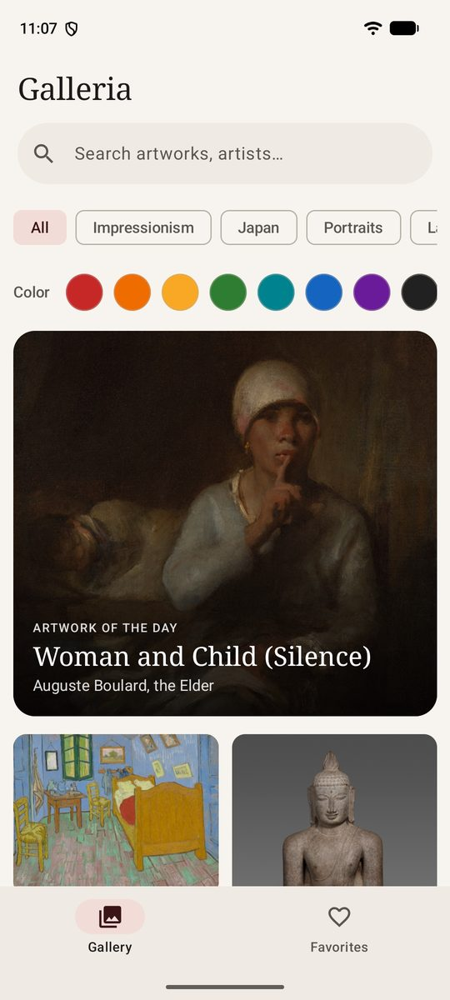
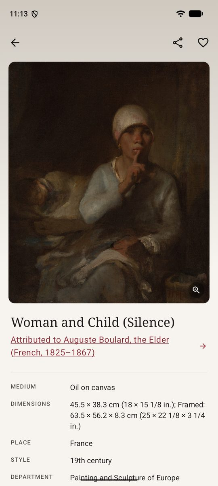
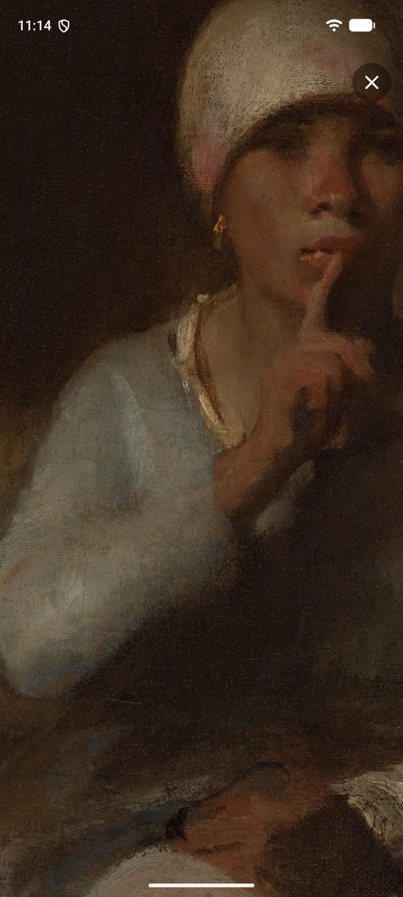
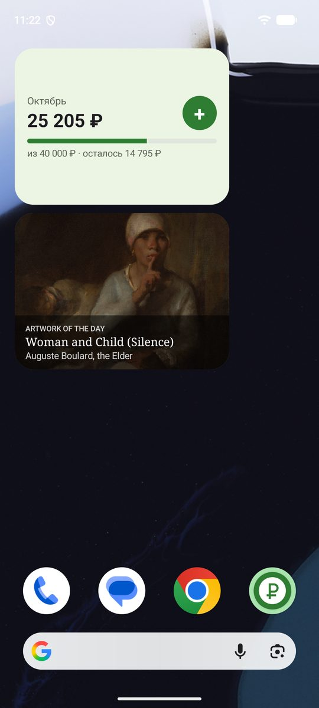
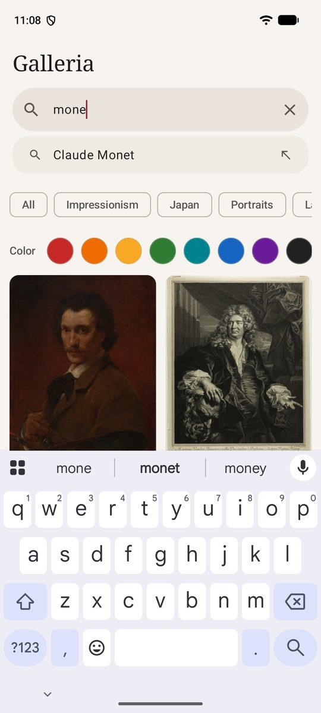
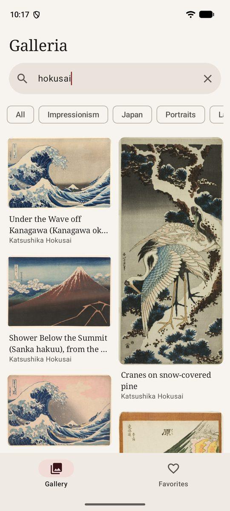
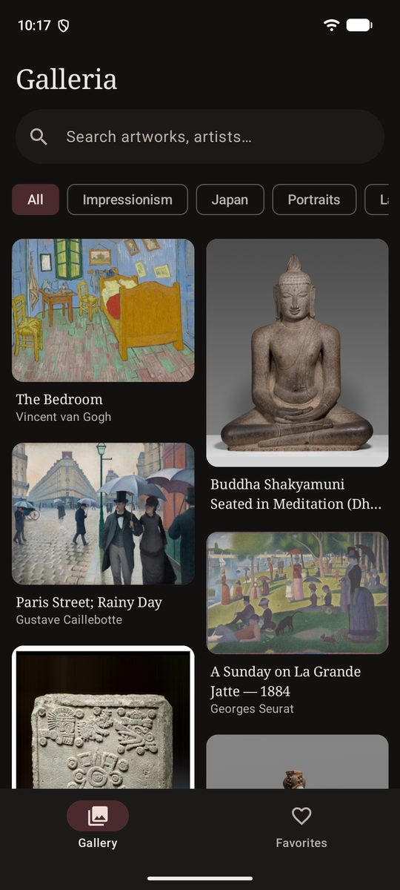
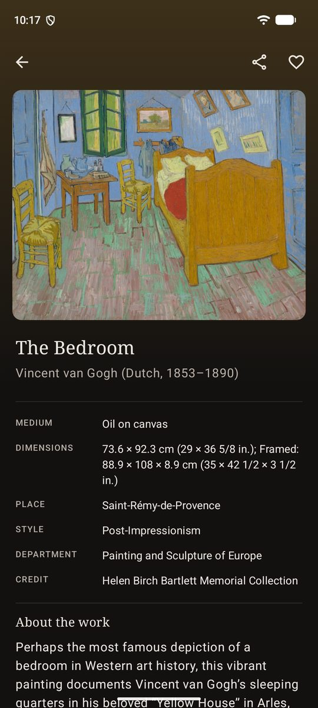
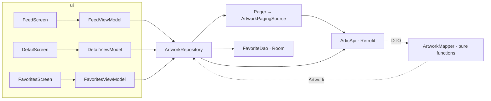

# Galleria 🖼

**An Android art gallery: 60,000+ public-domain works from the Art Institute of Chicago — endless feed, search by text and by color, a smooth "tile → artwork" transition, deep zoom down to the brushstrokes, an immersive slideshow, a home-screen widget and offline favorites.**


<p align="center">
  
  
  
  
</p>
<p align="center">
  
  
  
  
</p>

## Features

**New in 1.1**

- 🔬 **Deep zoom** — beyond the base image the viewer loads only the visible **IIIF tiles** of the original at the right level (`data/Iiif.kt`, own Canvas renderer): zoom up to pixel-for-pixel with an 8,800 px original and see the canvas weave and brushstrokes, with a live "detail: N % of the original" badge
- 🎨 **Search by color** — swatches above the feed filter by the painting's dominant hue (HSL ranges, red wraps around 0°); combine with search and collections
- 🌅 **Artwork of the day** — a hero card above the feed (same painting for everyone that day) and a **Glance home-screen widget**, pinnable from the app, updated daily by the system
- 🎞 **Immersive mode** — full-screen vertical pager of paintings with a slow Ken Burns camera, a blurred backdrop made from the painting itself and auto-advance
- 🧑‍🎨 **Artist screen** — life years, biography and all public-domain works; the artwork screen gets "More by the artist" and "Similar in color" rows, an "On view · Gallery 243" badge, a parallax image and an accent color taken from the painting
- 🔎 **Search that doesn't fire on every letter** — 650 ms pause, at least 3 letters, "Search" on the keyboard goes at once, museum autocomplete suggestions; old results stay (dimmed) under a thin progress bar instead of a jumping spinner
- 🛟 **Resilient to the museum's API** — HTTP cache for API responses plus "serve the last saved answer" on no network or 5xx (the API sometimes answers 504 under load)

**1.0**

- 🧱 **Endless staggered feed** (`LazyVerticalStaggeredGrid` + Paging 3) — tiles have the right height *before* the image loads (aspect ratio comes from the API), so the feed never jumps; a tiny blurred preview (`lqip`) fills the tile until the real image fades in
- 🔎 **Search with debounce** (400 ms) — stale requests are cancelled with `flatMapLatest`; clearing the field goes back instantly; collections (Impressionism, Japan, Portraits…) as chips
- ✨ **Shared element transition** — the tile image flies into place on the artwork screen; the already-downloaded thumbnail is reused as the placeholder for the large image, so there is no blank frame
- 🎨 **Color from data** — the artwork screen is tinted with the painting's dominant color (HSL from the API → ARGB), tuned for both light and dark theme
- 🔍 **Full-screen viewer** — pinch to zoom (up to 5×) around the fingers, pan within the image bounds, double-tap to zoom into a point, swipe down to close
- ♥ **Favorites in Room** — stored whole (title, image URLs, color, preview), so they open without network; remove with **Undo**
- ⚠️ Honest states: skeleton on first load, "No connection · Retry" for the page and the footer, "Nothing found", and the end of the feed (the API serves at most 1,000 results per query)
- 📱 Bottom bar on phones, navigation rail on tablets and in landscape (`NavigationSuiteScaffold`); 2–5 columns by window width
- 🌓 "Museum" theme — warm paper and burgundy, serif headings, dark theme; edge-to-edge, splash screen, adaptive + monochrome icon
- 🌐 English and Russian, per-app language on Android 13+

## Tech stack

| Category | Choice |
|---|---|
| UI | Jetpack Compose · Material 3 · Navigation Compose (type-safe routes) · Shared element transitions · Material 3 Adaptive |
| Architecture | MVVM + UDF: stateless screens `Screen(state, callbacks)`, ViewModels expose `StateFlow` / `Flow<PagingData>` |
| DI | Hilt |
| Async | Kotlin Coroutines + Flow |
| Paging | Paging 3 (`PagingSource` keyed by page number, `cachedIn(viewModelScope)`) |
| Images | Coil 3 on the same OkHttp client as the API (memory + disk cache, crossfade) |
| Network | Retrofit + OkHttp + kotlinx.serialization |
| Storage | Room (favorites) · `SavedStateHandle` (search and collection survive process death) |
| Widget | Glance (`updatePeriodMillis`, no WorkManager needed), `requestPinAppWidget` |
| Quality | 49 JVM tests (incl. tile math, `SearchQuery` → JSON, OkHttp cache on MockWebServer) · 9 Compose UI tests · Room AutoMigration 1→2 · earlier: 27 JVM tests (mapper on real API responses, `PagingSource` with `TestPager`, ViewModels with virtual time and Turbine) · 6 Compose UI tests on an emulator in CI · Android Lint · R8 in release |

## Architecture

One `app` module with layers as packages — the focus of this project is UI (multi-module setup is shown in [SkyCast](https://github.com/vihrea1337/skycast)).



- **The model knows nothing about the API.** `ArtworkMapper` (pure Kotlin, tested with plain JUnit) builds IIIF image URLs, clamps extreme aspect ratios (scrolls, panoramas), converts HSL to ARGB, decodes the `data:` preview and turns the museum's HTML description into text.
- **Two navigation levels**: `Home` (tabs Gallery · Favorites) and `Detail(id)`. Tabs are state of `Home`, not destinations — both feeds live in the same animation scope, so the shared element works from either, and scroll positions survive tab switches.
- **The artwork screen is instant**: the tapped `Artwork` is remembered in the repository, so the image, title and color show immediately; only the details (facts, description) are fetched.

## Decisions & trade-offs

| Decision | Why |
|---|---|
| Page key = API page number, `initialLoadSize = pageSize` | Paging asks for 3× the page size on the first load by default; with page-number keys page 2 would then overlap page 1 and the feed would show duplicates |
| Stop at 990 results | The API rejects `page × limit > 1000`; the source never asks for it, and the UI says "That's all — refine the search" |
| Explicit Coil `memoryCacheKey` | Coil 3's default memory key includes the requested size, so the detail screen could not find the feed thumbnail by URL; an explicit key makes the thumbnail a real placeholder |
| Favorites stored whole, not as ids | Opens offline and doesn't depend on what the API returns later |
| Search + collection in `SavedStateHandle` | Survive rotation **and** process death |
| Own IIIF tile renderer instead of a zoom library | The museum serves tiles natively; loading only visible 256 px tiles of the right level keeps memory flat even for 75-megapixel originals — and it's a nice thing to explain |
| API query as JSON `params` (`SearchQuery.toParams`) | The search endpoint accepts Elasticsearch-style queries: text in `q` ranks, filters (public domain, color ranges, artist, type) cut — one pure, tested function |
| Strip `Vary`/`no-cache` from API responses in a network interceptor | The museum marks everything uncacheable; for a read-only catalogue a 10-minute cache plus stale-on-error makes the app usable when the API is slow |
| No offline cache for the feed | Galleria is about UI; offline-first sync is already shown in my other projects (SkyCast, Expenses, DevLog) |

## Build

```bash
./gradlew assembleDebug                 # debug APK
./gradlew test                          # JVM tests
./gradlew connectedDebugAndroidTest     # Compose UI tests (emulator or device)
./gradlew assembleRelease               # R8; signed if keystore.properties is present
```

Requires JDK 17+ and Android SDK 36. No API keys needed.

## Data & credits

Artwork data and images: [Art Institute of Chicago API](https://api.artic.edu/docs/). Only works in the **public domain** are shown (`is_public_domain = true`); the app identifies itself with the `AIC-User-Agent` header as the museum asks.

## License

[MIT](LICENSE)
